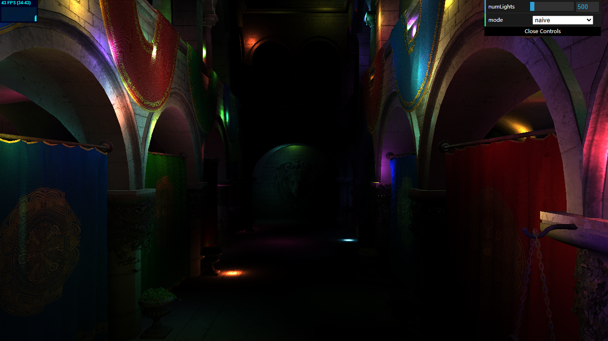
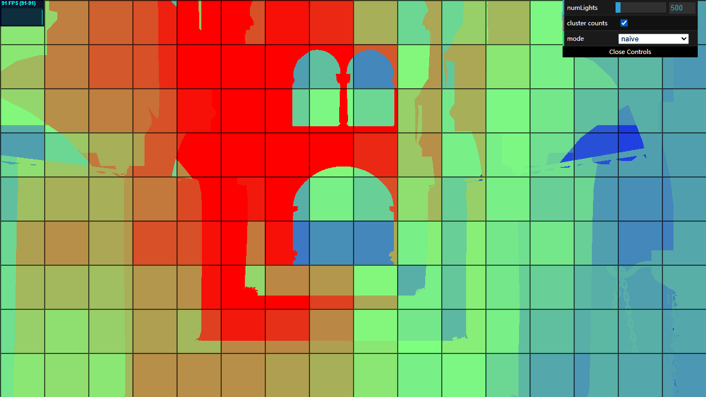
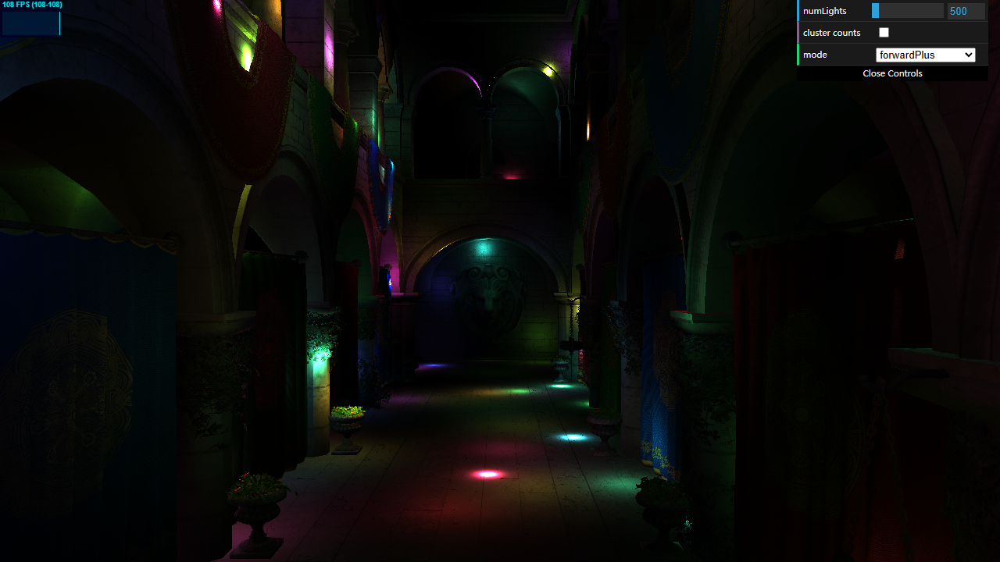
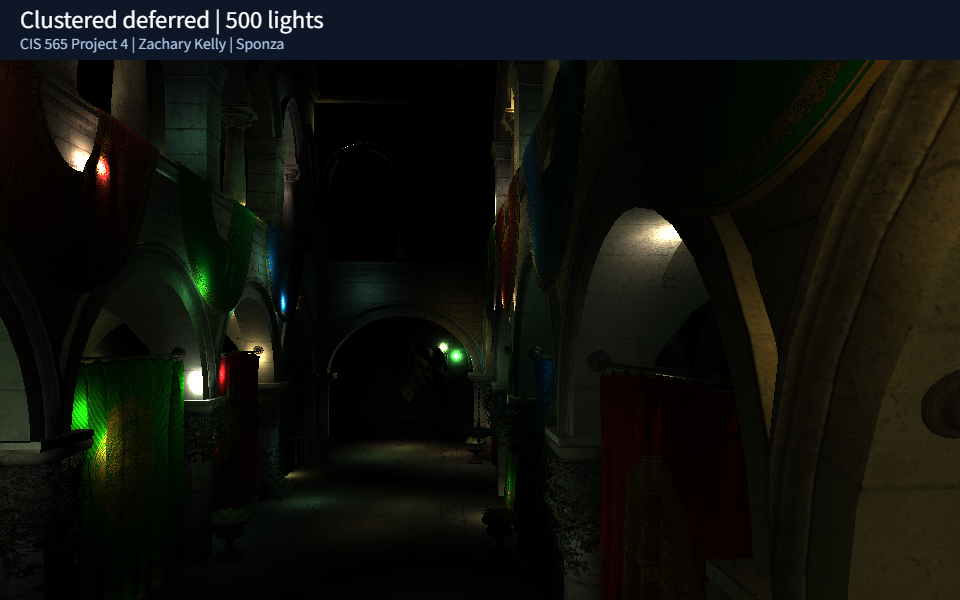
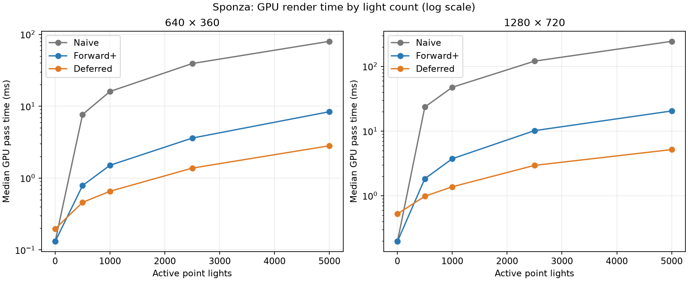
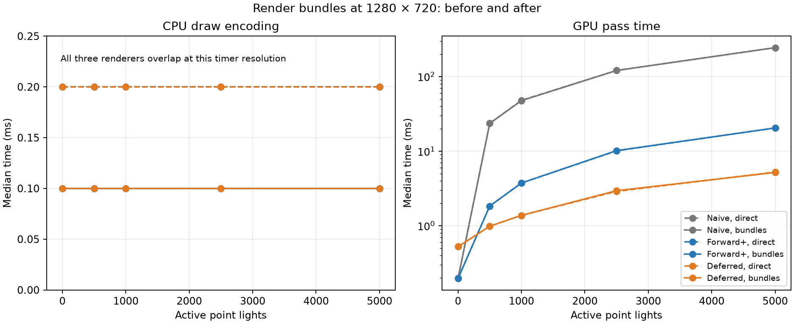

# WebGPU Forward+ and Clustered Deferred Shading

**University of Pennsylvania, CIS 565: GPU Programming and Architecture — Project 4**

Zachary Kelly

The naive, Forward+, and clustered deferred renderers draw the Sponza scene with animated point lights.
Naive shading checks every light for each fragment. Forward+ first groups the
lights into view-space clusters, then checks only the lights in each fragment's
cluster. Clustered deferred stores surface data before lighting visible pixels.

[Live WebGPU demo](https://zkelly1.github.io/Project4-WebGPU-Forward-Plus-and-Clustered-Deferred/) · [36-second video](https://zkelly1.github.io/Project4-WebGPU-Forward-Plus-and-Clustered-Deferred/demo.webm)

The video shows all three renderers, animated lights and camera movement, the
cluster count view, and 5,000-light rendering with bundles enabled.



## Build and run

Run from the repository root:

```powershell
npm install
npm run dev
```

The project needs Node.js and a browser with WebGPU support. The initial renderer
was checked on Windows in Chrome 155.0.8059.40 at 1280 × 720. The screenshot above
uses the default 500 lights. Performance measurements are included below.

Use naive, forward+, or clustered deferred in the mode menu. Render bundles
are enabled by default and can be switched off for comparison.

| Input | Action |
| --- | --- |
| W / S | Move forward / backward |
| A / D | Move left / right |
| Q / E | Move down / up |
| Hold left mouse button and drag | Look around |
| Shift | Move faster |
| Alt | Move slower |
| numLights | Change the active light count, from 1 to 5,000 |
| cluster counts | Show the number of lights assigned to each visible cluster |
| render bundles | Reuse recorded geometry draw commands, or issue them directly |

## Naive forward rendering

The camera stores its view-projection matrix at the start of its uniform buffer.
Each frame updates the matrix after processing movement and copies it to the GPU.
The scene bind group exposes this buffer to the vertex shader at binding 0;
the light buffer stays at binding 1.

The vertex shader transforms each model-space position into world space, then
uses the camera matrix to place it on screen. World position, normal, and texture
coordinates pass through to the existing fragment shader. That shader samples
the material texture and adds the contribution from every active light.

The scene loader, camera controls, light animation, and lighting calculation
come from the starter. This stage fills in the missing camera buffer, bindings,
and vertex transformation. The full light loop is unchanged so later renderers
can be compared against it.

## Light clustering

The view is split into 16 columns, 9 rows, and 24 depth slices. Depth spacing is
logarithmic between the camera's near and far planes, so slices are thinner near
the camera. The camera buffer now also holds the view matrix, inverse projection,
viewport size, and clipping distances, for a total of 208 bytes.

Each compute invocation handles one cluster. It unprojects the eight corners,
finds their view-space bounding box, and tests every light against that box.
A light is included when the closest point on the box lies within its radius.
These boxes enclose the clusters, so they can include extra lights near the
corners. Both lighting shaders apply the distance falloff.

Each cluster stores two bounds, a light count, and the indices of its lights.
One thread owns the list and writes its count every frame. Old entries beyond
that count are ignored, so shrinking a list does not need a separate clearing
pass. Clustering runs after light movement and before the debug draw.

For now, each list has space for all 5,000 lights. That avoids dropping lights
when they crowd into one cluster, but the 3,456 clusters take about 66 MiB.
This is a simple starting point, not a compact allocation. Shorter lists with
an overflow fallback or packed lists would reduce the memory cost later.



Enable **cluster counts** in any renderer to see the lists on the scene.
Blue means zero lights, green means 32, and red means 64 or more. Red only caps
the display color; it does not mean the list was truncated. The dark lines show
the screen tiles. Different depths within one tile can have different counts.
The view keeps the material's alpha cutoff, including holes in the foliage.

Turning this off returns to normal lighting. The naive renderer skips clustering
when the debug view is off; Forward+ needs the lists for lighting and always
runs the compute pass.

### Checking the lists

With the development server running, open `/tests/clustering.html`. This page
compares GPU results against CPU bounds built from projection scales and a
separate sphere-box calculation. It checks every cluster's bounds and light
indices, rather than relying only on the debug colors.

The checks cover empty input, one light, 5,000 scattered lights, 5,000 overlapping
lights, and clearing the counts after a full list. They also cover exact tangency,
lights behind the camera and across the clipping planes, a moved and rotated
camera, and a portrait projection. Pixel/depth lookup is checked at 868 points
for each of the landscape and portrait projections. All checks pass in Chrome.
The page reports GPU validation errors as failures.

## Forward+



Forward+ runs the clustering compute pass and the geometry pass in the same
command encoder. The geometry pass uses the same vertex shader, material
textures, alpha cutoff, and depth test as the naive renderer.

The fragment shader uses screen position for the tile and view-space depth for
the depth slice. It reads the cluster through a pointer, then walks its light
indices without copying the list. Each light uses the starter's lighting and
distance falloff. The lists are built in light-index order, which also keeps
the order of contributing lights consistent with the naive shader.

Open `/tests/forward_plus.html` with the development server running to compare
the two renderers. The check freezes the camera and light buffers, renders each
mode, and reads back the pixels. It covers 0, 1, 500, and 5,000 lights, dropping
back to one light after 5,000, a changed camera and light positions, a portrait
projection, and the cluster debug view. The one-light case places a light near
the floor so the image contains visible lighting.

All eight comparisons matched exactly in Chrome at the tested 640 × 360 and
360 × 640 resolutions, including pixels along the cluster boundaries. The check
allows at most one 8-bit color step of rounding difference and treats GPU
validation errors as failures. This checks correctness. The performance section measures render time separately.

## Clustered deferred shading



The geometry pass writes world position to `rgba32float`, normalized world
normals to `rgba16float`, and sampled albedo to `rgba16float`. These attachments
use 32 bytes per pixel in total. Position stays at full precision to preserve
light distances and cluster lookup. Half-float albedo avoids the visible rounding
errors found with 8-bit storage. The pass keeps the same alpha cutoff and depth
test as Forward+. Position alpha marks covered pixels; cleared pixels remain
transparent black, including when there are no lights.

A fullscreen triangle reads the three attachments with `textureLoad`, finds the
pixel's cluster, and evaluates its lights. Clustering, geometry, and fullscreen
lighting run in order in one command encoder. The cluster counts toggle also
works in this renderer and uses the stored world position.

Open `/tests/clustered_deferred.html` to compare against naive rendering with
frozen camera and light buffers. All eight comparisons passed in the in-app
browser at 640 × 360 and 360 × 640: 0, 1, 500, and 5,000 lights, returning to one
light, moved camera and lights, cluster debug, and portrait projection. Maximum
channel difference was 1/255 for lighting and zero for the empty and debug
cases. No GPU validation errors were reported. The checks also verify that enabling
render bundles leaves every output byte unchanged.

## Render bundles

The scene is static, but the camera and lights move. Each renderer records its
geometry commands once in a render bundle, then reuses those commands each frame.
The bind groups still refer to the current camera and light buffers, so animation
continues without rebuilding the bundle. Lighting and debug pipelines have
separate cached bundles. Switching renderers destroys their attachment textures.

The GUI's **render bundles** checkbox selects the direct draw path or cached
bundle path. This is the measured optimization and the render-bundle extra-credit
feature. It reduces JavaScript traversal and command encoding, while leaving the
shaders and GPU draw work unchanged. A scene with changing meshes or bindings
would need to invalidate and rebuild the bundles; this demo keeps those fixed.

## Performance analysis

Measured on 2026-10-13 on Windows with an NVIDIA GeForce RTX 3070
(driver 32.0.16.1656), AMD Ryzen 7 3700X, and the Chromium 155 in-app browser.
The browser reports NVIDIA Ampere; hardware names came from Windows.

The benchmark holds the camera and light positions fixed at the initial Sponza
view, with light animation sampled at 2,000 ms. Each configuration gets two
rounds of 12 warm-up frames and 20 measured frames per round (40 samples total).
The second round reverses the bundle/direct order. Tables report the median.
The cluster grid stays at 16 × 9 × 24, and cluster debug is disabled.

GPU time is the sum of timestamp-query durations for clustering and rendering
passes. It excludes light animation, asset loading, query resolution/readback,
queue waiting, and display presentation. CPU time wraps draw(), including command
encoding, query-resolution commands, and submission, but excludes the asynchronous
readback wait. The queue is drained between frames, so these are isolated render
costs rather than pipelined frame latency or FPS. Raw samples and metadata are in
[results/benchmark.json](results/benchmark.json). Browser timer quantization and
scheduling noise limit precision, especially for sub-millisecond CPU results;
small differences should not be read as reliable speedups.

### Rendering methods

GPU milliseconds with render bundles enabled:

| Resolution | Lights | Naive | Forward+ | Deferred |
| --- | ---: | ---: | ---: | ---: |
| 640 × 360 | 1 | 0.131 | 0.131 | 0.197 |
| 640 × 360 | 500 | 7.668 | 0.786 | 0.459 |
| 640 × 360 | 1,000 | 16.056 | 1.507 | 0.655 |
| 640 × 360 | 2,500 | 39.322 | 3.604 | 1.376 |
| 640 × 360 | 5,000 | 80.085 | 8.389 | 2.818 |
| 1280 × 720 | 1 | 0.197 | 0.197 | 0.524 |
| 1280 × 720 | 500 | 23.527 | 1.835 | 0.983 |
| 1280 × 720 | 1,000 | 47.514 | 3.736 | 1.376 |
| 1280 × 720 | 2,500 | 120.521 | 10.158 | 2.949 |
| 1280 × 720 | 5,000 | 243.859 | 20.447 | 5.177 |



At 1280 × 720 with 5,000 lights, naive shading takes 243.859 ms,
Forward+ takes 20.447 ms, and deferred takes 5.177 ms.
Forward+ is 11.9× faster than naive in this case; deferred is
3.9× faster than Forward+. With only one light, deferred costs
0.524 ms versus 0.197 ms for Forward+,
so the extra G-buffer and fullscreen pass do not pay off for that workload.

The naive fragment loop scales with every active light. Clustering reduces that
loop to nearby lights, which explains the large improvement for both clustered
methods. Deferred performs lighting once per covered pixel after visibility has
been resolved. Forward+ can shade fragments that are later covered by nearer
geometry. This makes Sponza's overlapping surfaces a plausible reason for the
larger deferred advantage at high light counts; overdraw itself was not measured.

Increasing resolution from 640 × 360 to 1280 × 720 quadruples the pixel count,
while the clustering grid and the number of light/cluster tests stay fixed.
Geometry, G-buffer traffic, and per-pixel lighting grow with resolution. The
separate pass measurements at 1280 × 720 and 5,000 lights are:

| Renderer | Clustering (ms) | Geometry (ms) | Fullscreen lighting (ms) |
| --- | ---: | ---: | ---: |
| Naive | 0.000 | 243.859 | 0.000 |
| Forward+ | 1.835 | 18.612 | 0.000 |
| Deferred | 1.835 | 0.459 | 2.884 |

These are medians per pass, so their sum can differ from the median total.
Zero in an absent pass means that renderer does not run that pass.

Deferred uses 32 bytes of color attachments per pixel: 28.125 MiB at 1280 × 720,
plus depth. Forward+ needs only its depth attachment beyond the shared scene and
cluster data, making it preferable when attachment bandwidth or memory is tight.
Forward rendering also adapts more naturally to blended transparent materials;
this scene uses alpha cutoff, which all three paths preserve. These measurements
cover one GPU, scene, and camera view, rather than every workload.

### Render-bundle optimization

Before and after at 1280 × 720, in milliseconds:

| Renderer | Lights | CPU direct | CPU bundles | GPU direct | GPU bundles |
| --- | ---: | ---: | ---: | ---: | ---: |
| Naive | 500 | 0.200 | 0.100 | 23.593 | 23.527 |
| Forward+ | 500 | 0.200 | 0.100 | 1.835 | 1.835 |
| Deferred | 500 | 0.200 | 0.100 | 0.983 | 0.983 |
| Naive | 5,000 | 0.200 | 0.100 | 243.728 | 243.859 |
| Forward+ | 5,000 | 0.200 | 0.100 | 20.447 | 20.447 |
| Deferred | 5,000 | 0.200 | 0.100 | 5.243 | 5.177 |



Bundles reduce repeated JavaScript scene traversal and draw-command encoding.
The GPU executes the same geometry and shaders, so large GPU improvements are
not expected. CPU timings are coarsely quantized; the raw samples and graph show
both improvements and cases with no distinguishable change. GPU variations of a
few timestamp steps are measurement noise, not evidence of a shader optimization.

The best case is a static scene with many draw calls and CPU submission overhead.
The worst case is a GPU-bound workload or frequently changing meshes/bindings:
bundles cannot shorten the lighting loop, and rebuilding them adds work. There
is also storage and one-time recording overhead. Warm-up includes that first
recording, so the table measures steady-state reuse. Both draw paths remain
available in the GUI, and pixel comparisons verify that bundles change no colors.

### Remaining optimization opportunities

Each cluster currently reserves room for every possible light, using about
66 MiB. Packed lists or bounded lists with an explicit overflow fallback could
reduce that allocation. The current compute shader tests every light for every
cluster; transforming lights into view space once and skipping empty clusters
could lower that cost. More clusters can shorten per-pixel lists, but increase
compute work and list memory, so that tradeoff needs its own grid-size sweep.

The debug view shows crowded clusters in red. Those clusters have longer
fragment loops, though red saturates at 64 lights and is not an overflow signal.
A depth prepass could reduce Forward+ overdraw, while position reconstruction
and packed normals could reduce deferred attachment bandwidth. These are future
work, not implemented or claimed as extra credit here.

## Progress

- [x] Install dependencies and run the development server.
- [x] Complete the camera uniforms and naive renderer.
- [x] Check camera movement and light counts of 1, 500, and 5,000.
- [x] Build and debug the cluster light lists.
- [x] Implement Forward+.
- [x] Implement clustered deferred shading.
- [x] Compare render times and record optimization results.
- [x] Add the live demo and video.

`npm run typecheck` and `npm run build` pass. The build type-checks first and
copies scene assets with Node, so the same command works on Windows and Linux.

## Reproducing the checks

With the development server running:

- /tests/clustering.html: GPU light lists against independent CPU checks.
- /tests/forward_plus.html: naive/Forward+ image comparison and bundle equivalence.
- /tests/clustered_deferred.html: naive/deferred image comparison and bundle equivalence.
- /tests/benchmark.html: press Run benchmark, then download the full timing data.
- /tests/demo.html: record the scripted 36-second feature tour and screenshot.

The correctness pages fail on GPU validation errors. Benchmarking requires the
optional WebGPU timestamp-query feature and reports an error if it is unavailable.
Normal rendering does not require timestamp queries and performs no query readbacks.

For uninterrupted recordings and benchmarks, use `npm run validate:serve` and
open the test page at `http://127.0.0.1:5174`. Adding `?save=1` to the benchmark
or demo page saves its output into `results/` or `img/`. The local validation
server only accepts those three fixed output files from its own origin.
Run `python scripts/plot-results.py` with Matplotlib installed to regenerate
the graphs from the saved JSON.

## Credits

- CIS 565 project starter and supplied Sponza scene
- [Vite](https://vitejs.dev/)
- [loaders.gl](https://loaders.gl/)
- [dat.GUI](https://github.com/dataarts/dat.gui)
- [stats.js](https://github.com/mrdoob/stats.js)
- [wgpu-matrix](https://github.com/greggman/wgpu-matrix)

API references: [WebGPU timestamp queries and render bundles](https://www.w3.org/TR/webgpu/).
No third-party rendering implementation was copied; the dependencies listed above are from the starter.
